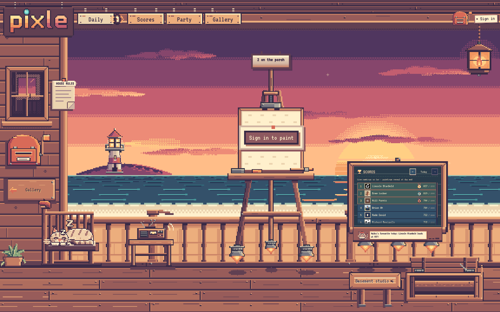
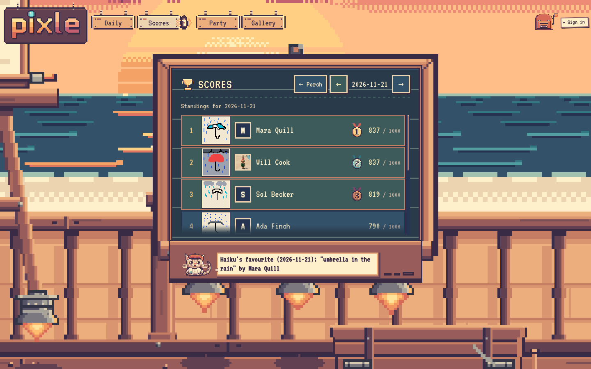
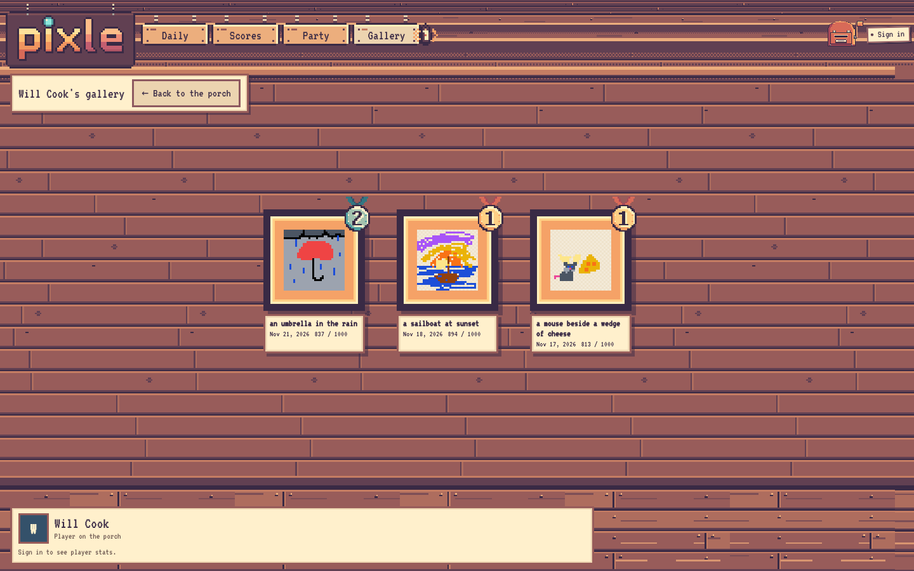
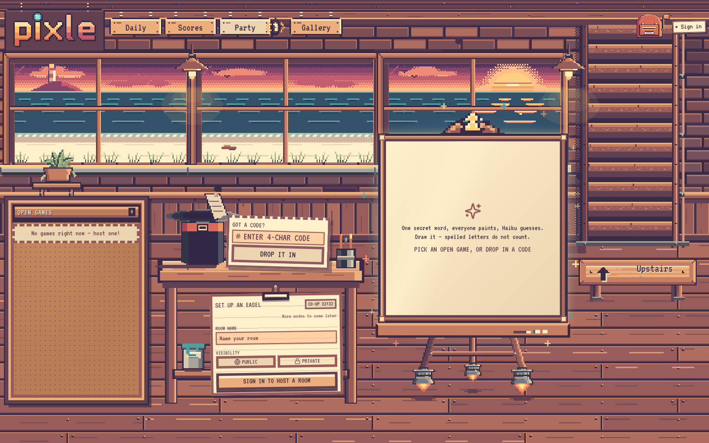
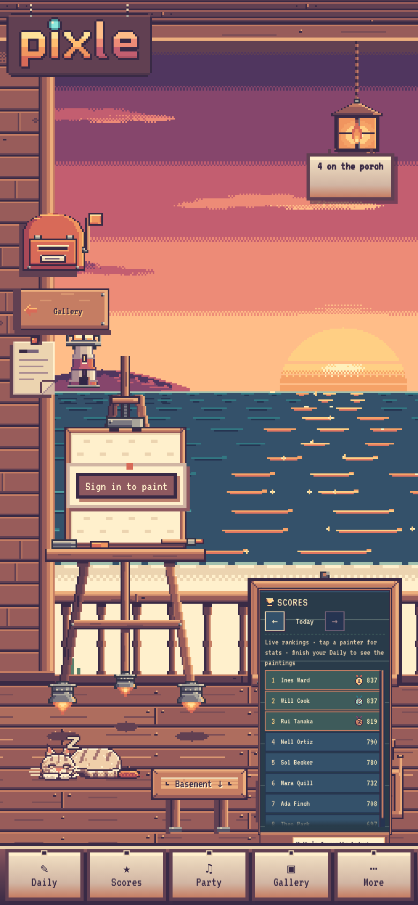
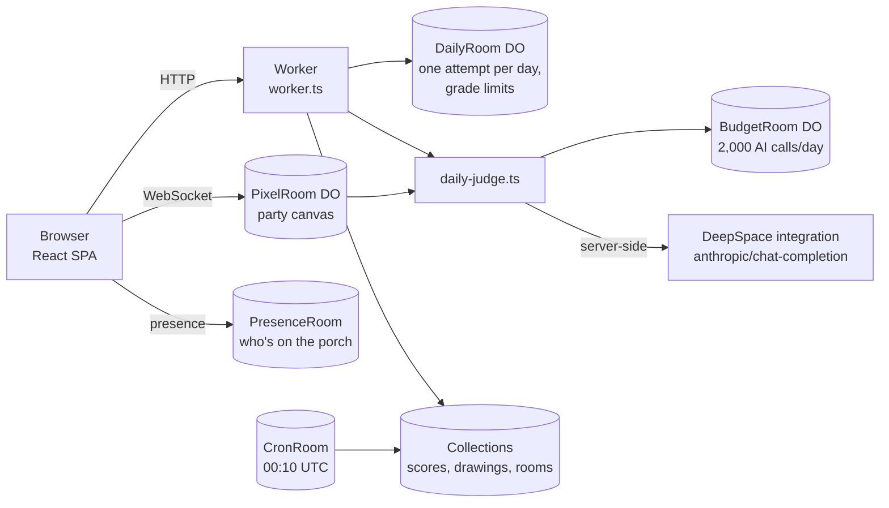

<p align="center"></p>

<h1 align="center">Pixle</h1>

<p align="center">
  A daily 5-minute pixel-art challenge, judged by Claude Haiku. Built on <a href="https://docs.deep.space">DeepSpace</a>.<br>
  <b><a href="https://pixle.app.space">pixle.app.space</a></b>
</p>

<p align="center"></p>

## What it is

Everyone gets the same prompt each day ("a lighthouse in a storm") and one attempt: up to 5 minutes on a 32×32
canvas. Claude Haiku looks at the drawing without being told the prompt, guesses what it shows, and then scores it out
of 1000. Scores go on a daily leaderboard, drawings hang in each player's gallery, each player has stats, and when the
day closes the top three get medals.

A second mode, **Party** (`/party`), is a live shared canvas: someone hosts a room, friends join from the open-games
list (private rooms need the code), and everyone click-and-drags on one canvas while Haiku calls out guesses until it
gets the word. There is no score in Party; co-op is the only mode for now.

| Daily leaderboard | A player's gallery | Party studio |
|---|---|---|
|  |  |  |

<p align="center"><br><sub>On a phone</sub></p>

## How a Daily works

1. Sign in (first time: pick a username) and press **Start**. The server opens your one attempt for today (UTC) and
   starts the clock.
2. Paint for up to 5 minutes. Haiku judges once at the halfway point (2:30) and gives a final verdict when you
   **Submit**, or automatically at 5:00. Two non-scoring peeks along the way are just Haiku being a cat critic.
3. Each judgement is two model calls: a **blind guess** (Haiku doesn't know the prompt), then a **score** with the
   prompt:
   - **Matches the prompt**, 0–500: the prompt match, weighted 60/40 with whether the blind guess got the subject
     (capped low when it didn't).
   - **Art quality bonus**, 0–500: pixel-art craft, paid in proportion to the match, so great art of the wrong thing
     earns almost nothing.
   - Spelling the answer in letters doesn't count as drawing it.
4. Your higher judgement is your score; the painting shown is your latest canvas. Today's drawings unlock once you've
   finished your own attempt, and go public when the day closes.

## Architecture



| DeepSpace feature | Used for | Code |
|---|---|---|
| Auth | Play needs sign-in; the worker reads identity from the verified JWT. Boards and galleries are public. | `src/server/daily-routes.ts` |
| `anthropic/chat-completion` | Vision judging, server-side only. It's the only DeepSpace integration that accepts images. Client-side integration calls are refused. | `src/server/daily-judge.ts`, `src/game/judge.ts` |
| `BaseRoom` Durable Objects | `DailyRoom`: one attempt per user per day, atomic in SQLite. `PixelRoom`: validates every pixel and fans it out over WebSocket (a per-painter token bucket, so drags feel instant). `BudgetRoom`: a shared daily cap on AI calls. | `src/server/*-room.ts` |
| Collections + permissions | Scores, drawings, rooms, rounds, usernames (`profiles`, unique) and party stats. Server-written, public-read; private rooms are member-only. | `src/schemas/` |
| Cron | Closes each day: reveals drawings and awards medals. | `src/cron.ts`, `src/server/daily-close.ts` |
| Presence | "3 on the porch · 1 painting now". Held in memory; nothing is stored. | `src/components/porch/PorchPresence.tsx` |

**Why my own Durable Objects for pixels.** Records and `CanvasRoom` don't fit pixels. A record `put` broadcasts
the whole record, so a tile-per-record canvas would resend a tile on every pixel, and a get-then-update action can
race the per-painter rate limit. `CanvasRoom` is a Yjs document of freeform shapes. A `BaseRoom` gives one atomic
validate-and-write per pixel and tiny broadcasts, the same pattern DeepSpace's own game examples use.

**Left out on purpose:** payments (nothing to sell), email, AI image generation (the point is that people draw), and
voice.

## Repository map

```
worker.ts                 Worker assembly: routes, Durable Object exports, cron
src/server/               HTTP routes, Durable Objects, judge, daily close
src/game/                 Pure game logic (grid, rules, scoring, judge prompts), unit-tested
src/game/daily/           Daily prompts, schedule and scoring
src/pages/                Routes (file-based): porch, scores, galleries, party studio, rooms
src/components/, src/scene/   UI and the pixel-art scene / camera
src/schemas/              Collection schemas and permissions
tests/                    Playwright: offline browser suite and real-worker specs
docs/progress.md          Running log of decisions, findings and verification
docs/superpowers/         Design specs and implementation plans
docs/screenshots/         README images (captured from the live site, other players' names replaced)
```

## Running it

Requires Node 22, 24 or 26 and npm 11.6+.

```sh
npm install
npm run dev          # local dev server (Vite + Miniflare); uses a fake judge, so no paid AI calls
npm run verify       # lint, type-check, unit tests, build
PIXLE_TEST=1 npm run build && npx playwright test --config tests/offline.playwright.config.ts   # offline browser suite
```

`PIXLE_TEST=1` keeps the dev-only controls the offline suite drives; a production build strips them. CI runs `verify`
and the offline browser suite on every push and pull request.

If your OS has reduced motion turned on, Pixle skips its camera moves between scenes (everything still works); turn it off to see the transitions.

## How it was built

Built over five days with coding agents: Claude Code planned and reviewed, and Codex, Gemini and OpenCode models did
most of the implementation. Each change was reviewed by a different model family before it merged. Decisions,
findings and verification are logged in [`docs/progress.md`](docs/progress.md). Agent instructions are in
[`AGENTS.md`](AGENTS.md).
